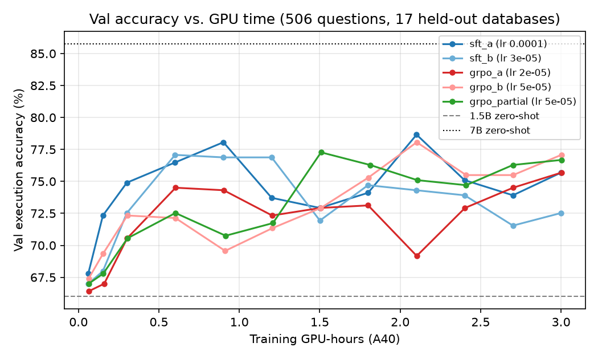

# RL post-training for text-to-SQL: GRPO vs. supervised fine-tuning

Can a small model learn to write SQL from **execution feedback alone**, and how
does that compare with ordinary supervised fine-tuning on the same data and the
same GPU budget?

I post-trained `Qwen2.5-Coder-1.5B-Instruct` two ways on Spider:

- **SFT**: LoRA fine-tuning on the gold SQL.
- **GRPO**: reinforcement learning. The model samples 8 queries per question,
  each is executed in a sandboxed SQLite database, and the reward is 1 if the
  result matches the gold result, else 0. The model never sees the gold SQL.

Both use the same LoRA setup, the same training questions and 3.0 GPU-hours on
one A40.

## Results

Execution accuracy (%), checkpoints selected on a held-out validation split,
test sets evaluated once.

| Model | Spider dev (n=1,034) | BIRD dev (n=1,534, never trained on) |
|---|---|---|
| Qwen2.5-Coder-1.5B, untuned | 62.2 | 28.7 |
| + SFT on gold SQL | 69.5 | 29.6 |
| + GRPO, execution reward | **70.2** | **35.3** |
| Qwen2.5-Coder-7B, untuned (reference) | 76.8 | 53.8 |

- **In distribution (Spider), GRPO matches SFT**: +0.7 points, 95% CI
  [−2.3, +3.8]. Both gain about 8 points over the untuned model.
- **Out of distribution (BIRD), GRPO transfers and SFT does not**: GRPO is
  +5.7 points over SFT (95% CI [+2.9, +8.9], McNemar p < 0.001), while SFT is
  not significantly better than the untuned model.
- GRPO got there after seeing **under half of the training questions once**;
  SFT made about 8 passes over all of them.
- A partial-credit reward (ablation) did not clearly beat the binary reward.



The full write-up, with statistics, a manual review of 20 predictions and the
limitations, is in **[REPORT.md](REPORT.md)**.

## What is in the repo

| Path | Contents |
|---|---|
| `src/sql_exec.py` | Sandboxed SQLite execution: read-only copies, SELECT-only authorizer, timeout, row cap |
| `src/rewards.py` | Binary and partial-credit rewards, scored in a process pool with a gold-result cache |
| `src/train_grpo.py`, `src/train_sft.py` | The two training arms (TRL `GRPOTrainer`, PEFT LoRA), both stopped on a shared GPU-time budget |
| `src/evaluate.py` | Batched evaluation with vLLM |
| `src/stats.py`, `scripts/analyze.py` | McNemar test, database-clustered bootstrap, tables and figures |
| `configs/` | Frozen prompt, LoRA, per-arm hyperparameters, GPU budget |
| `results/` | Raw predictions and metrics for every run, including the ones that lost |
| `tests/` | 54 unit tests for execution, rewards, splits and statistics |

## Reproduce

```bash
python -m venv .venv && .venv/bin/pip install -e ".[dev]"
python scripts/download_data.py spider && python scripts/download_data.py bird
pytest
python -m src.evaluate --split val --gold-as-pred --out results/g0_val   # sanity gate: must be 100%
bash scripts/setup_gpu.sh     # on a 48 GB GPU: training and evaluation environments
bash scripts/run_all.sh       # 2 SFT + 2 GRPO runs, selection on val, ablation (~16 GPU-hours)
bash scripts/run_final.sh     # test sets, once
python scripts/analyze.py     # every number and figure in this README and the report
```

Exact package versions are in `requirements-train.lock` and
`requirements-eval.lock`. Total compute for the project was about 19 hours on
one A40.

## Scope

One seed, one small model, two hyperparameter settings per method. Accuracy is
measured by comparing result sets (the BIRD rule), which is not Spider's
official test-suite metric, so the Spider numbers are not comparable with
leaderboard entries. See the limitations section of the report.
