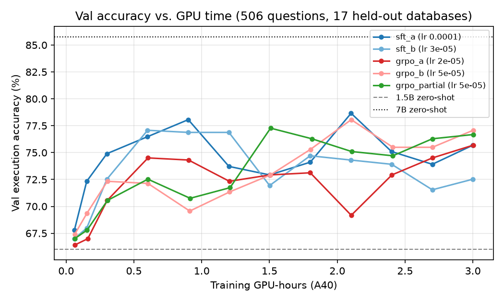
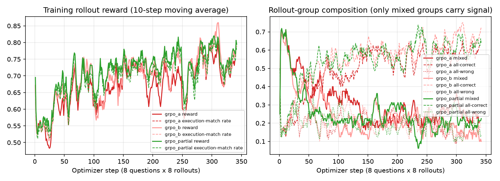

# Report: GRPO vs. SFT for text-to-SQL on a 1.5B model

## 1. Question

Text-to-SQL has a reward that can be checked exactly: run the query and compare
the rows with the gold answer. That makes it a clean setting to ask whether
reinforcement learning from execution feedback (GRPO) is competitive with
supervised fine-tuning (SFT) on gold SQL, when both get the same model, the
same training questions and the same GPU time.

## 2. Setup

| | |
|---|---|
| Model | `Qwen2.5-Coder-1.5B-Instruct`, LoRA r=16 on all linear layers (18.5M trainable parameters), identical for both methods |
| Training data | Spider train, 6,090 questions (see limitations for what was dropped) |
| Validation | 506 Spider questions from 17 databases held out from training; used for all checkpoint and hyperparameter selection |
| Test | Spider dev (1,034 questions, 20 databases) and BIRD dev (1,534 questions, 11 databases). Evaluated once, after everything was frozen. BIRD is never trained on |
| Metric | Execution accuracy: `set(predicted rows) == set(gold rows)`, greedy decoding |
| Budget | 3.0 GPU-hours per run on one A40; 2 learning rates per method; 12 checkpoints saved at fixed fractions of the budget |

**SFT** minimises cross-entropy on the gold SQL (about 3.6 s per step of 16
questions, 8 epochs in 3 hours).

**GRPO** samples 8 completions per question at temperature 1.0, executes each,
and gives reward 1 for a matching result and 0 otherwise; no KL term
(TRL `GRPOTrainer`, `loss_type="grpo"`, `beta=0`). One step of 8 questions × 8
rollouts takes about 32 s, so 3 hours is 342 steps: 21,888 executed queries
covering 45% of the training questions once.

**Execution sandbox.** Generated SQL only ever runs against a read-only copy
of the database, with a SELECT-only authorizer, a single-statement check, a
10 s timeout and a row cap.

The prompt, decoding settings and comparison rule were frozen before any
training run. A gold-as-prediction check scores 100% on train and val, and a
negative control (gold SQL from a different question on the same database)
scores 6.3%.

## 3. Results

Execution accuracy (%). "Best" is the checkpoint with the highest validation
accuracy; "end" is the last checkpoint at 3.0 GPU-hours.

| Model | Val | Spider dev | BIRD dev | Executable on Spider / BIRD |
|---|---|---|---|---|
| 1.5B untuned | 66.0 | 62.2 | 28.7 | 82.5 / 55.3 |
| SFT, best | 78.7 | 69.5 | 29.6 | 90.0 / 64.3 |
| SFT, end | 75.7 | 70.8 | 30.3 | 91.3 / 64.5 |
| GRPO, best | 78.1 | 70.2 | 35.3 | 92.8 / 71.9 |
| GRPO, end | 77.1 | 71.9 | 32.4 | 93.0 / 63.2 |
| GRPO partial-credit (ablation), best | 77.3 | 72.8 | 34.2 | 93.0 / 69.3 |
| GRPO partial-credit (ablation), end | 76.7 | 72.2 | 32.3 | 94.8 / 68.4 |
| 7B untuned (reference) | 85.8 | 76.8 | 53.8 | 97.2 / 90.9 |

Paired comparisons on the same questions. Confidence intervals are from a
bootstrap that resamples whole databases; p-values are exact McNemar tests.

| Comparison | Test set | Difference | 95% CI | p |
|---|---|---|---|---|
| GRPO − SFT (best) | Spider dev | +0.7 | [−2.3, +3.8] | 0.67 |
| GRPO − SFT (best) | BIRD dev | +5.7 | [+2.9, +8.9] | < 0.001 |
| GRPO − SFT (end) | Spider dev | +1.1 | [−3.7, +6.2] | 0.49 |
| GRPO − SFT (end) | BIRD dev | +2.1 | [−0.2, +5.2] | 0.08 |
| SFT − untuned | Spider dev | +7.4 | [+3.2, +12.2] | < 0.001 |
| SFT − untuned | BIRD dev | +0.9 | [−2.3, +3.9] | 0.51 |
| GRPO − untuned | Spider dev | +8.0 | [+4.0, +12.5] | < 0.001 |
| GRPO − untuned | BIRD dev | +6.6 | [+2.4, +11.2] | < 0.001 |
| Partial − binary reward (best) | Spider dev | +2.6 | [−0.6, +6.4] | 0.03 |
| Partial − binary reward (best) | BIRD dev | −1.1 | [−3.0, +0.6] | 0.26 |

**What the numbers support.**

1. *On Spider, GRPO and SFT are indistinguishable.* Both improve the untuned
   model by 7–8 points; the difference between them is under a point with a
   confidence interval several points wide.
2. *On BIRD, GRPO transfers better than SFT.* At the validation-selected
   checkpoints GRPO is 5.7 points ahead and the interval excludes zero. SFT
   does not significantly improve on the untuned model there. At the
   end-of-budget checkpoints the gap is smaller (+2.1) and not significant, so
   the size of this effect depends on the checkpoint; its direction does not.
3. *GRPO is far more sample-efficient per question but slower per step.* It
   reaches SFT-level accuracy from 45% of the questions seen once, without the
   gold SQL, at about 9× the wall-clock cost per step.
4. *Partial credit is inconclusive.* It is slightly better on Spider and
   slightly worse on BIRD; neither interval excludes zero.
5. *A 5× larger untuned model is still better* than either post-trained 1.5B
   model, by about 6 points on Spider and 18 on BIRD.

A plausible reason for point 2: SFT learns to imitate Spider's annotation
style, which does not carry over to BIRD, while GRPO is only rewarded for
queries that run and return the right rows, which does. Consistent with this,
GRPO raises the share of executable queries on BIRD from 55% to 72% (SFT: 64%).
This is an interpretation, not something the experiment isolates.

## 4. Training dynamics

SFT peaks early and then drifts down by 3–5 points on validation, which is
typical of overfitting after several epochs. GRPO climbs more slowly and is
still at or near its best at the end of the budget.

During GRPO the share of sampled queries that match the gold result rises
from 56% to 73%, and the share that execute from 77% to 93%. Only groups with
both correct and incorrect rollouts produce a gradient under a binary reward;
their share falls from about 50% to 13% as the model becomes consistent, so
the learning signal thins out over training.

## 5. Manual review

I read 20 Spider dev predictions (5 each: GRPO right / SFT wrong, SFT right /
GRPO wrong, both wrong, both right with SQL different from gold); the sample
is in `results/review_candidates.md`.

- **No coincidental matches**: every prediction scored correct in the sample
  was semantically right.
- **2 of the 5 "both wrong" questions were false negatives of the metric**: in
  one, both models differed from gold only in column order; in the other, five
  countries tie for the answer and `LIMIT 1` picked a different one. The
  metric is therefore somewhat pessimistic for every row.
- **SFT errors were mostly hallucinated tables or columns**; GRPO fixed these.
- **GRPO errors were mostly dropped conditions or a missing aggregate.**
- **GRPO changed the model's style**: it prefers `IN (subquery)` over joins
  and drops table aliases, producing shorter queries (27–29 tokens on average
  against 39). This style runs slowly on a few large BIRD databases, where 27
  GRPO queries hit the 10 s timeout.
- **No reward hacking found**: all 15,223 rewarded training rollouts are single
  SELECT statements (the sandbox rejects anything else). One real blind spot:
  because results are compared as sets, a query with and without `DISTINCT`
  earns the same reward, so the reward cannot teach that distinction.

## 6. Limitations

- **One seed per configuration.** Validation accuracy moves by 2–4 points
  between neighbouring checkpoints, so small differences are noise.
- **Two learning rates per method**, nothing else tuned.
- **Checkpoints were selected on a 506-question validation split**, which
  favours whichever method is noisier; end-of-budget results are reported next
  to best-on-val for that reason.
- **Not Spider's official metric.** Result-set comparison on one database
  instance can accept wrong queries and, as the review shows, reject right
  ones. The Spider numbers are not comparable with leaderboard entries.
- **The equal budget is GPU time, not data.** GRPO saw 45% of the training
  questions once; a longer budget might change the comparison in either
  direction.
- **Data dropped identically from both methods:** 164 questions whose prompt
  exceeds 1,536 tokens (memory), and 239 whose gold SQL returns no rows or
  fails to execute (an empty gold result would reward any query that returns
  nothing).
- **Few test databases** (20 and 11), which is why intervals are clustered by
  database and wide. One BIRD gold query fails to execute and counts as wrong
  for every model.
- **One small model.** Nothing here says how the comparison goes at larger
  scale.

## 7. Reproducibility

Every number above is generated by `scripts/analyze.py` from the raw
predictions in `results/`, which include the runs that were not selected.
Configurations are in `configs/`, package versions in the two lock files, and
the frozen data split in `data/splits.json`.
